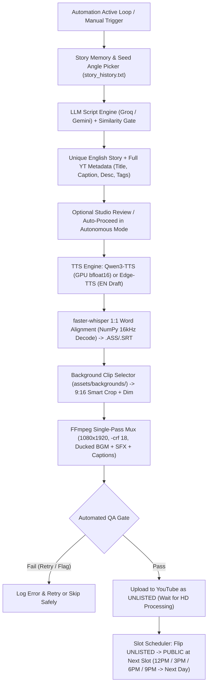

# Faceless Shorts Automation (v2) — Clean Architecture & Requirements

> **Purpose:** Complete greenfield specification for building **v2** of the Faceless Shorts & Reels Studio in a brand-new repository.  
> **Key Pivot from v1:** Drop all procedural 2D Python/PIL animation (`character_rig`, `props_engine`, `scene_planner`) in favor of **real high-retention gaming background clips (`assets/backgrounds/`)** cropped cleanly to `9:16`, **English-only LLM-generated scripts (Groq / Gemini)**, **local Qwen3-TTS GPU voice synthesis**, **word-level `.ASS` karaoke captions**, **autonomous end-to-end story creation & YouTube channel uploading**, **multi-day slot scheduling**, and a **clean, modern React + Tailwind creator dashboard**.

---

## 1. Core Design Decisions (v2 Pivot)

| Area | v1 (Retired) | v2 (New Requirement) |
|---|---|---|
| **Language** | English + Hinglish dual pipeline | **Strictly English-only** end-to-end (scripts, voiceover, captions, and YouTube metadata) |
| **Visuals / Background** | Procedural 2D PIL character rigs & sets | **Real gaming clips** placed in `assets/backgrounds/` (auto-cropped to `1080x1920`, muted, randomly picked/trimmed or user-pinned) |
| **Script Generation** | Hardcoded / template-based skits | **Proper LLM Engine** using **Groq** and **Google Gemini** API keys (`.env`) with structured JSON beats, topic deduplication, & per-line regeneration |
| **Voiceover (TTS)** | Mix of prototypes + Hinglish routing | **Alibaba Qwen3-TTS (`0.6B-CustomVoice`)** on local CUDA GPU (`bfloat16`) for natural English narration, with optional **Edge-TTS (`en-US`)** fast-draft/fallback toggle |
| **Subtitles** | `faster-whisper` `.ASS` | Kept & simplified: **1:1 English word-level** Hormozi-style word-pop `.ASS` captions (`faster-whisper` via WAV-to-NumPy bypass) |
| **YouTube & Automation** | Manual / optional single-slot upload | **Integrated YouTube Channel Automation**: when active, autonomously generates a new unique story, renders, runs QA, uploads as **Unlisted** first so YouTube can fully process HD/Shorts, and flips to **Public** on sequential multi-day time slots (`12 PM`, `3 PM`, `6 PM`, `9 PM`, then next day...) |
| **Backend API** | Single-file `http.server` | **FastAPI + Uvicorn** (`127.0.0.1:8765`) with typed schemas, multipart clip upload, autonomous automation worker, YouTube OAuth/scheduler, and SSE live logs |
| **Frontend Dashboard** | Monolithic CSS / cramped layout | **Modern Studio UI** (React + Vite + Tailwind CSS + Lucide icons) focused on automation control, scheduled upload calendar, script editing, clip management, and 9:16 preview |

---

## 2. End-to-End Pipeline Flow



---

## 3. Target Repository Structure (Clean Greenfield Layout)

```text
faceless-shorts-v2/
├── .env.example                    # GROQ_API_KEY, GEMINI_API_KEY, schedule & YT defaults (never commit .env)
├── .gitignore
├── requirements.md                 # This specification
├── start_studio.bat                # Launches FastAPI backend + Vite React frontend
├── config/
│   ├── client_secret.json          # Google Cloud OAuth 2.0 credentials (gitignored)
│   └── token.json                  # Persisted YouTube OAuth refresh token (gitignored)
├── assets/
│   ├── backgrounds/                # User-supplied gaming clips (.mp4/.mov/.mkv/.webm) + .gitkeep
│   ├── music/                      # Optional background music tracks (.mp3/.wav) + .gitkeep
│   └── sfx/                        # Optional punchline SFX (whoosh, pop, ding, vine_boom)
├── models/
│   ├── qwen3-tts-0.6b/             # Downloaded Qwen/Qwen3-TTS-12Hz-0.6B-CustomVoice weights
│   └── whisper/                    # faster-whisper base int8 model cache
├── backend/
│   ├── requirements.txt            # Minimal pinned Python dependencies (no unused packages)
│   ├── main.py                     # FastAPI app (API routes, SSE logs, upload, automation & YT endpoints)
│   ├── config.py                   # Pydantic Settings loading .env, schedule slots, & folder paths
│   ├── schemas.py                  # Pydantic models for Script, Beat, RenderJob, ClipInfo, ScheduleSlot
│   ├── llm_engine.py               # Groq + Gemini unified English script writer & per-beat rewriter
│   ├── story_memory.py             # Lightweight story_history.txt registry, seed angles & similarity rejection gate
│   ├── tts_engine.py               # Qwen3-TTS (GPU bf16 batched) + Edge-TTS (EN) fast-draft fallback
│   ├── captions.py                 # faster-whisper 1:1 word timing + Hormozi .ASS/.SRT generator
│   ├── video_composer.py           # Gaming background selector, 9:16 smart crop, FFmpeg render
│   ├── qa_gate.py                  # ffprobe + loudness + subtitle validation
│   ├── scheduler.py                # Multi-day slot allocator (12PM/3PM/6PM/9PM -> next day) & state store
│   ├── youtube_uploader.py         # YouTube Data API v3 OAuth2 auth, channel info & scheduled Shorts upload
│   └── automation_worker.py        # Background autonomous loop (Generate -> Render -> QA -> Schedule Upload)
├── frontend/
│   ├── package.json                # React 18, Vite, Tailwind CSS, lucide-react
│   ├── tailwind.config.js
│   └── src/
│       ├── App.jsx
│       ├── api/client.js
│       ├── components/
│       │   ├── AutomationBar.jsx   # Active/Paused automation toggle, live cycle state, next slot & quota meter
│       │   ├── ScriptSidebar.jsx   # Queue, search, status filters (Draft, Rendered, Scheduled, Failed)
│       │   ├── ScriptEditor.jsx    # LLM prompt bar, beat editor, inline AI rewrite, duration meter
│       │   ├── BackgroundPicker.jsx# Grid of gaming clips from assets/backgrounds/ + drag-drop upload
│       │   ├── PhonePreview.jsx    # 9:16 live clip + subtitle safe-zone preview & final MP4 player
│       │   ├── ScheduleCalendar.jsx# Multi-day 12PM/3PM/6PM/9PM YouTube schedule board & upload history
│       │   ├── RenderDrawer.jsx    # Live progress %, step status, collapsible log stream
│       │   └── SettingsModal.jsx   # Provider status (Groq/Gemini), YouTube Channel OAuth, schedule slots & caps
└── data/ & output/                 # Runtime scripts, story_history.txt, schedule_state.json, QA JSONs, rendered MP4s (gitignored)
```

---

## 4. Functional Module Requirements

### 4.1 LLM Script Generation Engine (`backend/llm_engine.py`)
Focus heavily on writing **retention-optimized, natural, non-robotic English scripts** rather than generic facts.

- **Strictly English-Only:** All generated narration, captions, titles, descriptions, and tags are strictly in natural, punchy English.
- **Supported Providers (via `.env`):**
  - **Groq** (`GROQ_API_KEY`): Primary ultra-fast inference (e.g., `llama-3.3-70b-versatile`, `openai/gpt-oss-120b`, or user-selectable Groq model).
  - **Google Gemini** (`GEMINI_API_KEY`): Official `google-genai` SDK (e.g., `gemini-2.5-flash`, `gemini-2.5-pro`).
  - Automatic fallback: if the primary provider hits rate limits or times out, automatically fall back to the secondary provider if its key is configured.
- **Strict Structured Output (JSON Mode):**
  Every generated script returns validated JSON matching:
  - `id`, `title`, `topic`, `core_premise`, `preset`, `provider`, `model`, `language` (`"en"`), `tts_engine` (`"qwen3"` | `"edge"`), `background_clip` (`"random"` or filename)
  - `youtube_meta`: Generated **simultaneously with the script** so every Short is upload-ready without a second LLM call:
    - `title`: High-CTR Shorts title (`<= 100` chars, naturally engaging, includes `#Shorts`)
    - `caption`: Short punchy pinned-comment / social caption (`1–2` sentences + engagement question)
    - `description`: SEO-ready YouTube description with 2-line hook summary, CTA, and relevant `#Shorts` + niche hashtags
    - `tags[]`: `8–15` targeted English keywords/tags (kept within YouTube's `500`-char total tag limit)
    - `category_id`: YouTube category ID (e.g., `"24"` Entertainment, `"20"` Gaming, `"27"` Education)
    - `thumbnail_text`: Short `2–4` word cover text
  - `beats[]`: Each beat has:
    - `beat_id`
    - `speaker_role` (`"narrator"` or dialogue persona like `"host"` / `"guest"`)
    - `voice_gender` (`"male"` | `"female"`)
    - `emotion_instruct` (Natural Qwen3-TTS style/emotion prompt passed directly to `instruct=...`, e.g., `"Speak with urgent curiosity and a hushed storytelling tone"`, `"Sound shocked and incredulous"`, `"Warm, conspiratorial, conversational delivery"`)
    - `spoken_text` (Natural, conversational, storytelling English written specifically for realistic Qwen3-TTS prosody — everyday contractions, natural breath pauses via `...` and em-dashes `—`, dynamic sentence rhythm, rhetorical micro-beats, and zero flat textbook phrasing)
    - `sfx_cue` (`"none"` | `"pop"` | `"whoosh"` | `"ding"` | `"vine_boom"`)
- **Story Presets & Quality Rules:**
  - Presets: `Reddit / Storytime Twist`, `Crazy True Loophole`, `Dark 60s Mystery`, `What-If Chaos`, `Unbelievable History`, `Custom Prompt`.
  - **0–2s Hook Rule:** First beat must open mid-tension or with a shocking/funny claim. Explicitly forbid AI clichés (`"Did you know"`, `"Welcome back"`, `"Today we will talk about"`).
  - **Target Duration:** `28–52 seconds` (`~80–145` words total) with punchy beats (`~2–4s` each).
  - **Seamless Loop Ending:** Last sentence should grammatically or thematically flow back into Beat 1.
  - **Multi-Layer Anti-Repetition & Story Memory (`backend/story_memory.py`):**
    Because LLMs default to the same viral clichés even when told "don't repeat", deduplication uses **3 layers**:
    1. **Lightweight Plain-Text History File (`data/story_history.txt`):** Stores one compact line per generated story (`YYYY-MM-DD | <Preset> | <Title> | <5-8 word core premise/entities>`). At `~75 bytes/line`, even 200+ stories fit cleanly in the system prompt as a compact "DO NOT REPEAT ANY OF THESE" block without blowing up token limits.
    2. **Rotating Seed Angles:** Before calling the LLM in autonomous mode, `story_memory.py` injects a fresh, non-repeating **domain/setting/constraint seed** (e.g., specific era, profession, industry, or twist type) so the model explores genuinely new premises instead of recycling top training-data tropes.
    3. **Programmatic Similarity Rejection Gate:** Before accepting any generated script, `story_memory.py` checks normalized title, `core_premise`, and key-entity/n-gram overlap against all lines in `data/story_history.txt`. If similarity exceeds the threshold (e.g. `>= 0.45` or matching core entities), the backend **automatically rejects and regenerates** (up to `3` attempts) with explicit feedback naming the colliding story. Accepted stories are immediately appended to `data/story_history.txt` and `data/used_topics.json`.
  - **Micro-Edits with AI:** UI supports **"Regenerate Hook"** and **"Rewrite Beat"** actions so the user can polish individual lines in manual mode without regenerating the whole script.

---

### 4.2 Background Gameplay Video Engine (`backend/video_composer.py`)
Completely replaces procedural animation with real gameplay footage.

- **Clip Ingestion (`assets/backgrounds/`):**
  - Scan `assets/backgrounds/` for `.mp4`, `.mov`, `.mkv`, `.webm`.
  - Extract metadata once (`ffprobe`) and cache thumbnails in `data/bg_cache/`: duration, width, height, fps, aspect ratio.
  - Provide a UI upload endpoint (`POST /api/backgrounds/upload`) so users can drop clips directly into the dashboard or copy files into `assets/backgrounds/`.
- **Selection Modes:**
  - `Random Clip`: Picks a clip at a random valid start offset `[0, clip_duration - audio_duration - 1]` (or concatenates multiple random 5–8s gameplay cuts if `"Multi-Clip Switch"` mode is chosen). Tracks recently used clips/offsets to avoid repeating the same footage back-to-back.
  - `Pinned Clip`: User selects a specific clip from `assets/backgrounds/` and optionally picks a custom start timestamp (`start_sec`) + crop alignment (`center`, `left`, `right`).
- **Smart `9:16` Vertical Crop & Pre-Processing (`FFmpeg`):**
  - Target output: **`1080x1920`**, `30 fps` (or `60 fps` toggle), `yuv420p`, `H.264 -crf 18 -preset veryfast`.
  - For landscape (`16:9`) clips: scale height to `1920` and crop width cleanly to `1080` (`scale=-2:1920,crop=1080:1920:(iw-1080)/2:0`, or `x=0` for left / `x=iw-1080` for right).
  - If clip is shorter than audio duration: seamlessly loop (`-stream_loop -1`) or cross-cut to another gameplay clip in `assets/backgrounds/`.
  - **Always strip original clip audio (`-an`)** so game noise never clashes with TTS voiceover.
  - **Caption Contrast Scrim:** Apply subtle darkening/contrast (`eq=brightness=-0.05:contrast=1.06`) or optional center/lower-third soft dark gradient so white/yellow captions stay legible on bright Minecraft/GTA sky scenes.

---

### 4.3 Best TTS Engine (`backend/tts_engine.py`)
Retains the verified **Qwen3-TTS** GPU setup from v1 with exact hardware lessons documented:

- **Primary Engine — Alibaba Qwen3-TTS (`Qwen/Qwen3-TTS-12Hz-0.6B-CustomVoice`):**
  - Store weights locally in `models/qwen3-tts-0.6b/` (note: download directly or verify weights locally; `hf_xet` can stall on Windows when fetching via default cache).
  - **CUDA `bfloat16` Rule:** Load with `dtype=torch.bfloat16` when `torch.cuda.is_bf16_supported()` (`~2.16 GB` VRAM on RTX 4050 6GB). **Do NOT use `torch.float16`**, as it triggers `TensorCompare.cu` assertion failures during sampling on RTX 4050.
  - **Batch Inference & Emotional Storytelling Prosody:** Run `model.generate_custom_voice(...)` passing each beat's `emotion_instruct` to the `instruct` parameter so Qwen3-TTS modulates tone, pacing, suspense, and excitement per beat instead of flat reading. Resample `24000 Hz` -> `44100 Hz` PCM_16 WAV.
  - **English Voice Mapping:** Male -> `Ryan` (or `Aiden`), Female -> `Serena`.
- **Fast Draft / Fallback Engine (`edge-tts` — English):**
  - Keep an explicit UI & config toggle (`qwen3` vs `edge`) using natural English neural voices (`en-US-ChristopherNeural` / `en-US-AndrewNeural` for Male, `en-US-JennyNeural` / `en-US-AvaNeural` for Female) so users can run ultra-fast draft renders or fall back automatically if GPU is unavailable.
  - *(Future optional upgrade path: Qwen3-TTS `1.7B` VoiceDesign/Base voice cloning if upgrading GPU VRAM later.)*

---

### 4.4 Word-Level Captions & Audio Mastering (`backend/captions.py` & `video_composer.py`)
- **Single-Source Audio Truth (`faster-whisper`):**
  - Run `faster-whisper` (`base`, CPU `int8`, `language="en"`) locally on each generated beat `.wav`.
  - **CRITICAL PyAV 19 Fix (Verified in v1):** Do NOT pass a file path string directly to `model.transcribe(str(wav_path))` when `av >= 19` is installed, as `faster-whisper 1.2.1` passes `metadata_errors="ignore"` to `av.open()` and fails. Always decode `.wav` to a `16 kHz` mono `np.float32` array via Python stdlib `wave` + `numpy` and pass the array directly to `model.transcribe(...)`.
  - Lock English captions **1:1** to Whisper word timestamps for tight, frame-accurate word popping.
- **Hormozi `.ASS` Subtitle Styling:**
  - Canvas `1080x1920`, `2–3` uppercase words per screen, bold sans (`Arial Black` / `Impact`), thick black outline + shadow, yellow active-word pop (`&H00E1FF&`).
  - Positioned in the **visual sweet spot** (lower-center, `MarginV ~480–560`, safely above YouTube Shorts / Reels title & description overlay and clear of right-side action buttons).
- **Audio Mix:**
  - Concatenate beat WAVs with `120–160ms` natural gaps, mix optional subtle SFX on cue beats, add optional background music ducked cleanly via `FFmpeg sidechaincompress`, and normalize speech around `-14 LUFS`.

---

### 4.5 YouTube Channel Integration & Multi-Day Slot Scheduler (`backend/youtube_uploader.py` & `backend/scheduler.py`)
Core first-class module so every finished Short is uploaded to the user's YouTube channel and spaced across future time slots.

- **YouTube Channel OAuth 2.0 Integration (`youtube_uploader.py`):**
  - Uses official **YouTube Data API v3** (`google-api-python-client`, `google-auth-oauthlib`).
  - Reads OAuth client credentials from `config/client_secret.json` and persists/auto-refreshes tokens in `config/token.json`.
  - Exposes endpoints to:
    - Start OAuth consent flow (`GET /api/youtube/auth-url` & callback) and verify connection.
    - Fetch connected channel info (`GET /api/youtube/channel` -> channel title, handle, subscriber count, thumbnail).
    - Upload a rendered Short via resumable upload (`MediaFileUpload(..., resumable=True)`) with title, description, tags, `#Shorts`, `categoryId` (default `24` Entertainment or `20` Gaming), and `selfDeclaredMadeForKids: false`.
- **Two-Stage Upload & Processing Flow — Unlisted First, Public at Scheduled Slot:**
  1. **Upload as `unlisted` (`videos.insert`):** Every finished Short is uploaded immediately with `status.privacyStatus = "unlisted"`. This lets YouTube ingest, transcode SD/HD, and run Shorts/copyright checks **before** any subscriber sees it, while keeping it off the public channel feed.
  2. **Processing Verification (`videos.list`):** Before any video is eligible to go public, the scheduler verifies `processingDetails.processingStatus == "succeeded"` (so a half-processed/low-res Short is never deployed).
  3. **Scheduled Public Deployment (`videos.update`):** When the video's allocated time slot arrives (and processing has succeeded), the backend calls `videos.update` to flip `status.privacyStatus` from `"unlisted"` -> `"public"`.
  - Direct/immediate `public` uploading is **never** used in automation mode so the channel is never spammed and every Short is 100% processed before going live.
- **Sequential Multi-Day Slot Allocator (`scheduler.py`):**
  - **Default Daily Slots (Configurable via `.env` / Settings UI):**
    - `12:00`, `15:00`, `18:00`, `21:00` (`12:00 PM`, `3:00 PM`, `6:00 PM`, `9:00 PM`) in the user's configured local timezone (`SCHEDULE_TIMEZONE`, e.g. `Asia/Kolkata`).
  - **How Slot Assignment Works:**
    - Maintains persistent state in `data/schedule_state.json` (recording every allocated `slot_iso`, `script_id`, `youtube_video_id`, and `status`) and optionally reconciles against already-scheduled videos on the channel.
    - Enforces a minimum lead-time buffer (`MIN_SCHEDULE_LEAD_MINUTES=20`) so a video is never scheduled for a slot that has already passed or is too close for YouTube HD/Shorts processing.
    - Example starting at `11:00 AM` today:
      - Reel 1 -> `Today 12:00 PM`
      - Reel 2 -> `Today 3:00 PM`
      - Reel 3 -> `Today 6:00 PM`
      - Reel 4 -> `Today 9:00 PM`
      - Reel 5 -> `Tomorrow 12:00 PM`
      - Reel 6 -> `Tomorrow 3:00 PM`
      - Reel 7 -> `Tomorrow 6:00 PM`
      - Reel 8 -> `Tomorrow 9:00 PM`
      - Reel 9 -> `Day +2 12:00 PM` ... continuing seamlessly across multiple days.
    - If a slot fails to upload or is manually deleted, the slot is released and reused for the next video.
- **Quota & Runway Safeguards:**
  - **YouTube API Daily Quota Awareness:** Default YouTube Data API v3 quota is `10,000 units/day`, and each `videos.insert` costs `~1,600 units` (max ~6 uploads/day on default quota).
  - Support configurable `MAX_UPLOADS_PER_DAY` (default `5` to stay safely within 10,000 units) and `MAX_DAYS_AHEAD` (default `7` days of pre-scheduled content runway).
  - If YouTube returns `quotaExceeded`, the uploader does **not** discard the rendered Short — it marks it `ready_to_upload` in the local queue and automatically resumes uploading after quota resets (midnight Pacific Time).

---

### 4.6 Autonomous Automation Worker (`backend/automation_worker.py`)
Runs continuously in the background whenever automation is toggled **ACTIVE**.

- **Lifecycle & Controls:**
  - Persists `automation_active: true | false` in `data/automation_state.json` so it can optionally auto-resume on backend startup.
  - Controlled via Studio UI (`AutomationBar`) and API (`POST /api/automation/start`, `POST /api/automation/stop`, `POST /api/automation/run-once`, `GET /api/automation/status`).
- **Autonomous Cycle (while `automation_active == true`):**
  1. **Check Runway & Quota:** Verify scheduled runway is below `MAX_DAYS_AHEAD` and daily YouTube uploads are below `MAX_UPLOADS_PER_DAY` (if at limit, sleep cleanly and re-check periodically without wasting LLM/GPU calls).
  2. **Pick Fresh Story & Preset:** Rotate through configured English presets and generate a brand-new story + full YouTube metadata via `llm_engine.py` + `story_memory.py` (using `data/story_history.txt`, rotating seed angles, and the similarity rejection gate).
  3. **Render Short:** Generate voiceover (`Qwen3-TTS`), align `.ASS` captions (`faster-whisper`), pick a non-repeating gameplay clip from `assets/backgrounds/`, and compose the `1080x1920` `.mp4`.
  4. **Automated QA Gate (`qa_gate.py`):** Validate video resolution, duration (`20–59s`), audio loudness, non-empty captions, and zero corrupted frames. On failure, log diagnostics and retry (up to `MAX_RETRIES=2`) before moving on.
  5. **Upload as Unlisted & Assign Next Slot:** Reserve the next free multi-day slot (`12 PM` / `3 PM` / `6 PM` / `9 PM` -> next day) from `scheduler.py` and upload to YouTube as **`unlisted`** via `youtube_uploader.py` so HD processing completes ahead of time.
  6. **Background Slot Publisher Tick:** Independently checks due scheduled slots, confirms `processingDetails.processingStatus == "succeeded"`, and flips `unlisted` -> `public` on time (even if content creation is paused or runway is full).
  7. **Cooldown & Repeat:** Wait a configurable cooldown interval (e.g., `AUTOMATION_COOLDOWN_SEC=60`) and start the next story until paused, quota is reached, or `MAX_DAYS_AHEAD` is filled.
- **Live Observability:** Streams every step (`Generating Story` -> `TTS` -> `Captions` -> `FFmpeg` -> `QA` -> `Uploading to YouTube for Tomorrow 3:00 PM`) to the frontend via SSE.

---

### 4.7 Frontend Studio Dashboard Redesign (`frontend/`)
Design priority: **Clean, spacious, fast creator studio UI** (React 18 + Vite + Tailwind CSS + Lucide Icons) replacing the cluttered v1 UI.

- **Layout Architecture (Top Navigation + Automation Bar + 3-Zone Studio Workspace):**
  - **Top Bar:** Project title, connected YouTube channel pill (with online/auth indicator), active LLM badge (`Groq` / `Gemini`), TTS Engine quick toggle (`Qwen3 GPU` / `Edge Fast`), Settings button, and `+ New Script` CTA.
  - **Automation Control Strip (`AutomationBar`):**
    - Prominent **Automation ON / OFF** toggle switch.
    - Live status indicator (`Idle`, `Generating Story`, `Rendering`, `Uploading to YT`, `Waiting for Quota Reset`, `Runway Full`).
    - Next available upload slot badge (e.g., `Next Slot: Tomorrow 12:00 PM`) + Daily Upload Quota counter (`3 / 5 today`) + `Run 1 Now` trigger.
  - **Left Panel (`280px`) — Script Library & Queue:**
    - Filter tabs: `All`, `Draft`, `Rendered`, `Scheduled`, `Failed`.
    - Compact cards showing title, preset tag, duration estimate, scheduled publish time badge (if scheduled on YouTube), render status dot, and delete icon.
  - **Center Workspace (Fluid) — Script Studio / Schedule Calendar Tabs:**
    - **Tab 1 — Script & Story Studio:**
      - **AI Generator Bar (collapsible/pinned):** Topic input (or blank for auto-topic), English Story Preset pills, Provider/Model selector (`Groq` / `Gemini`), `Generate Script` button.
      - **Structured Beat Editor:** Clean numbered cards per beat showing:
        - Beat duration estimate + total reel timer (`Target: 30–50s`, warns if `> 58s`).
        - Editable English `spoken_text` field.
        - Speaker gender (`Male` / `Female`), SFX cue dropdown, move up/down, delete beat, and an inline **`Sparkles` AI Rewrite** button per beat (plus **"Regenerate Hook"** on Beat 1).
      - **YouTube Packaging Accordion:** Editable Video Title, Description, Tags, and Hook Summary generated by the LLM.
    - **Tab 2 — YouTube Schedule Board (`ScheduleCalendar`):**
      - Multi-day timeline grouped by date (`Today`, `Tomorrow`, `Day +2`, ...) showing the `12:00 PM`, `3:00 PM`, `6:00 PM`, `9:00 PM` slots, which Short occupies each slot, YouTube Studio link, and remaining runway.
  - **Right Panel (`380px`) — 9:16 Live Preview, Background Picker & Render:**
    - **9:16 Phone Preview Frame:**
      - Before rendering: Plays the selected gameplay background clip muted inside a `9:16` frame with an optional YouTube Shorts UI safe-zone + sample caption overlay.
      - After rendering: Plays the final rendered `.mp4` with real audio & burned-in captions, plus buttons for **Schedule Upload to YouTube**, **Download MP4**, or **Delete Video**.
    - **Background Clip Strip:** Quick switcher (`Random Clip`, `Multi-Clip Cuts`, or select thumbnail from `assets/backgrounds/`), crop alignment (`Left` / `Center` / `Right`), and `+ Upload Gameplay Clip` drag-and-drop button.
    - **Render Action & Live Progress:** Primary `Render Video` button -> live percentage bar, current stage (`LLM` -> `TTS Batch 2/4` -> `Whisper Align` -> `FFmpeg Crop & Mux` -> `QA` -> `YT Upload`), and expandable console log drawer (streamed via SSE).

---

## 5. Non-Functional, Environment & Reliability Constraints

1. **Zero Secret Exposure:** `GROQ_API_KEY`, `GEMINI_API_KEY`, and YouTube `config/client_secret.json` / `config/token.json` live strictly on the backend (gitignored) and are never returned to the frontend.
2. **Minimal Clean Dependencies (`backend/requirements.txt`):**
   - Keep only actively used libraries: `fastapi`, `uvicorn[standard]`, `python-multipart`, `pydantic-settings`, `groq`, `google-genai`, `torch`, `torchaudio`, `qwen-tts`, `soundfile`, `transformers`, `accelerate`, `edge-tts`, `faster-whisper`, `numpy`, `imageio-ffmpeg`, `google-api-python-client`, `google-auth-oauthlib`, `google-auth-httplib2`, `tzdata`.
   - Do **not** install unused packages (`pyttsx3`, `static-ffmpeg`, `twine`, `gradio`, `PIL` animation bloat, etc.).
3. **Platform Lessons Learned (Windows + RTX 4050 Checklist):**
   - PowerShell 5.1 does not support `&&` — use `;` in Windows automation scripts.
   - Always check `ffmpeg` path (system `ffmpeg` or `imageio_ffmpeg.get_ffmpeg_exe()`).
   - Use `torch.bfloat16` for Qwen3-TTS on RTX 4050 (never `float16`).
   - Decode WAVs with `wave` + `numpy` (`float32 @ 16kHz`) before calling `faster_whisper.WhisperModel.transcribe` to avoid PyAV 19 `metadata_errors`.
   - **YouTube API OAuth Verification Caveat:** Videos uploaded by an unverified Google Cloud OAuth app in "Testing" mode are locked to `Private` by YouTube (cannot be flipped to `unlisted` or `public` via API) until the OAuth app passes Google's YouTube API audit. Plan to submit for verification or use an approved project for hands-free `unlisted -> public` deployment.
   - **YouTube API Daily Quota Caveat:** Default quota is `10,000 units/day` (`videos.insert` = `1,600 units`, `videos.update` = `50 units`), allowing up to 5–6 uploads/day plus status flips unless a quota increase is approved. Default `MAX_UPLOADS_PER_DAY=5` keeps automation safe from hard errors.
   - **GitHub Version 2 Integration:** Developed on a dedicated `v2` branch of the existing GitHub repository so `v1` history on `main` stays untouched until `v2` is ready to merge/promote.

---

## 6. Build Order for the New Project

1. **Scaffold & Config:** Clean directory tree, `.gitignore`, `.env.example`, `backend/requirements.txt`, `FastAPI` skeleton, and clip ingestion from `assets/backgrounds/`.
2. **LLM English Script Studio:** Implement `groq` + `google-genai` structured English beat generation, topic deduplication (`used_topics.json`), and inline beat rewrite APIs.
3. **Audio, Caption & Gameplay Composer Pipeline:** Wire `tts_engine.py` (`Qwen3-TTS bf16` + `edge-tts` EN fallback), `captions.py` (`faster-whisper` NumPy decode + 1:1 `.ASS`), `video_composer.py` (`9:16` crop/loop + scrim + `.ASS` burn + music ducking), and `qa_gate.py`.
4. **YouTube OAuth & Multi-Day Slot Scheduler:** Implement `scheduler.py` (`12 PM`, `3 PM`, `6 PM`, `9 PM` -> next day slot allocation & state persistence) and `youtube_uploader.py` (OAuth2 connect flow, channel info, and scheduled `publishAt` Shorts uploads with quota handling).
5. **Autonomous Automation Worker:** Implement `automation_worker.py` so toggling automation ON continuously creates new unique English stories, renders them, passes QA, and schedules them across upcoming days on YouTube.
6. **Frontend Dashboard v2:** Build the React + Tailwind Studio UI with `AutomationBar`, `ScheduleCalendar`, script/beat editor, background clip uploader/previewer, YouTube OAuth settings, and SSE live log drawer.
